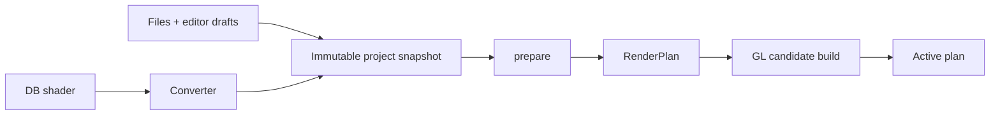

# Architecture and integration notes

Read SPEC.md for semantics. This file suggests boundaries and identifies existing integration points. Names here are conceptual; extend existing classes where practical rather than introducing parallel abstractions with nearly identical responsibilities.

## 1. One preparation path, one renderer



There is one dialect and one producer of plans. A database shader is converted to project files in memory (SPEC 12) and then takes the same path as a folder. The converter is a pure text transformation; nothing after it knows where a snapshot came from, and there are no `if legacy` branches anywhere.

## 2. Minimal concepts

| Concept | Owns | Does not own |
| --- | --- | --- |
| Project locator/store | Read/write capability, stable local identity, logical-path-to-storage mapping, external revision checks | GLSL, GL handles, editor widgets |
| Editing session | Active file, per-file drafts and undo, dirty/save state, requested revision | Render dependency semantics |
| Project snapshot | Immutable text and revision-specific asset contents/references, entry and diagnostics provenance | Mutable provider reads during drawing |
| Program description | Prepared shader text, language/version, source map, interface requirements | A unique render pass or live GL context |
| Input binding | Target uniform symbol, source resource/producer, temporal mode, sampler settings | Global name lookup |
| Pass description | Instance identity, program reference, input bindings, output target | Storage origin |
| Executable plan | Linked programs, ordered passes, per-program bindings, target/history allocations | UI drafts or SAF access |

### Seams

Three seams carry the design. `prepare` takes shape in M1–M4, `ProjectFiles` in M7, and `PlanRuntime` in E15–E17; ENGINE.md is its design. Keep everything else private to its module. Names are conceptual; the shapes are not.

```text
ProjectFiles                       // storage, one instance per opened root
  read(path)  -> bytes + revision | absent | failed(reason)
  list(dir)   -> entries
  write(path, bytes, expectedRevision) -> outcome
  create / rename / delete            // where the store supports them

prepare(files, entryPath, limits) -> Preparation    // pure JVM: no Android, no GL
  Preparation.plan          RenderPlan, or none
  Preparation.diagnostics   path, line, severity, message
  Preparation.dependencies  every path read, with the revision used
  Preparation.files         the bytes that were read, so later stages use exactly these

PlanRuntime                        // one per GL context
  build(plan, capabilities) -> candidate | diagnostics
  activate(candidate)                 // at a frame boundary
  drawFrame(frameInputs)
```

`prepare` is the only code that understands manifests, host directives, includes, and the graph. Every consumer uses its result: rendering takes the plan, the editor takes the diagnostics, Share, Save a copy, and Set wallpaper take `dependencies`, and refresh compares the revisions in `dependencies` to decide whether to rebuild. For sharing, it still returns the dependencies it could collect when there is no plan: a path named by a directive is collected even when another part of that directive is invalid. The bytes it read stay with the result, so building, sharing and snapshotting never read a file a second time and cannot see a newer version of it. There is no second producer of `RenderPlan`.

`ProjectFiles` is an interface because the variation is real. Implementations: a directory (own storage, installed wallpaper snapshots, archive staging, JVM tests), a SAF tree, a draft overlay that wraps another store and serves unsaved editor text, and, until migration, a view over the database that serves converted shaders and library textures (SPEC 12.2). A wallpaper therefore renders a directory store through the same `prepare` and `PlanRuntime` as the preview.

Do not turn the other rows into interfaces with factories and registries. Plain records/value objects and a few concrete coordinators are sufficient. Keep `prepare` and the plan types free of Android so they have meaningful JVM tests. Text and binary assets are separate values; do not base64-encode images into `ShaderProjectFile.source`.

File authoring uses normalized shader paths as default pass identities. The runtime receives an explicit instance ID distinct from a program identity. Do not require identical source text to compile twice, but defer content-hash program caches until profiling justifies them. Shared includes and small wrapper files are the initial user-facing reuse mechanism.

## 3. Existing code to inspect

All paths below are under `app/src/main/java/de/markusfisch/android/shadereditor/` unless noted. The checkout may have evolved; verify actual callers before editing.

| Area | Starting points | Required integration |
| --- | --- | --- |
| Project models | `project/ShaderProject*`, `*ShaderProjectSource` | Keep origins/locators separate from semantic descriptions; support binary resources and revision snapshots |
| Editor/session loading | `activity/managers/ShaderManager`, `ShaderViewManager` | Stop reducing every session to the entry source; route save to its actual store |
| Navigation | `activity/managers/NavigationManager`, `activity/PreviewActivity` | Small recoverable session/snapshot identifiers instead of serialized project payloads |
| Editor UI | `fragment/EditorFragment`, `widget/ShaderEditor`, `view/UndoRedo` | File-aware editing, source diagnostics, separate per-file history |
| Source preparation | `opengl/ShaderSourcePreparer`, `PreparedShaderSource`, `ShaderLineMapping`, `ShaderError` | Replaced by `prepare`; the sampler pattern and `///` parsing move into the converter |
| Program lifecycle | `opengl/RendererProgramManager` | Candidate build/activation; old plan survives failed build |
| Rendering | `opengl/ShaderRenderer`, `ShaderRenderPipeline` | Consume ordered plan; targets per instance; project-wide frame transaction |
| GL/resources | `opengl/GlDevice`, `ProgramBindings`, `ShaderTextureResources`, GL wrappers | Per-input sampling, typed targets, queried limits, lifecycle ownership |
| Builtins | `opengl/BuiltinUniforms`, sensor/system/camera helpers | Graph-wide provider demand and frame capture; per-pass bindings/coordinate transform |
| Persistence/library | DAOs, `io/ExternalFile`, import/export helpers, library manager | Preserve DB-backed records; new native project registry and stores |
| Wallpaper | `service/ShaderWallpaperService`, preferences | Durable installed snapshot and preserved legacy selection/runtime behavior |
| Resource insertion | AddUniform activity/fragments, texture pickers | Generate native annotations and local copies for native sessions |

At the inspected base, `ShaderProjectSession` is serializable, `ShaderProjectFile` is text-only, preview callers extract `getEntryPointSource()`, and `saveShader()` writes back to the legacy database. The folder source class is not a complete SAF persistence layer. These are integration gaps, not a reason to replace the entire application architecture.

## 4. Preparation and validation order

1. Obtain a consistent requested snapshot and revision ID.
2. Read/validate manifest and entry; lex entry input annotations into unresolved input descriptions.
3. Resolve required shader dependencies with a visited/in-progress graph, recording edges without assuming previous edges are acyclic.
4. Assemble includes for each reachable program, consume annotations, and produce source maps. Perform path/metadata/conditional placement validation on original text.
5. Validate static current-edge DAG, targets, resource types, and host resource bounds.
6. Decode immutable image data on a worker; do not open files in draw calls.
7. On the GL thread, compile/link a candidate, inspect active uniform types, configure builtin demand, and allocate/upload resources.
8. Recheck revision freshness; activate only a completely ready candidate at a frame boundary.

Do not use linked-uniform optimization to rewrite explicit graph reachability. Reflection is appropriate for type checks and demand for implicit engine inputs such as backbuffer. It is not a substitute for parsing declared dependencies.

Cancellation/freshness rules apply to parse, decode, and GL completion. A cancelled candidate must release resources when safe. A failed activation never marks a draft saved or an old preview current.

## 5. CPU and GPU ownership

- UI owns editing intent and presentation of state. Storage/preparation workers own expensive CPU/I/O work.
- GL handles live on the owning context/thread. Never share handles between preview and wallpaper contexts.
- Immutable CPU snapshots may be reused; each context builds its own executable plan.
- Keep pending candidate and active plan separate. Building a new program must not clear active programs first.
- Distinguish deleting valid GL objects from discarding handles after context loss.
- Query capabilities once per context, then validate candidate requirements against that snapshot.
- A candidate holds linked programs and uploaded images. Render targets are allocated at activation, after the old plan's targets are released; histories reset on activation, so the two sets never coexist. Validate formats, sizes, and unit counts against the capability snapshot before activation, so allocation failure is rare; when it happens, report it and show the error state.

Keep a project-wide frame snapshot for time/sensors/camera. Per-pass `ProgramBindings` set the program's own target dimensions, coordinate-transformed pointers, explicit inputs, and fixed historical references. Avoid repeatedly configuring/releasing builtin listeners for each pass.

## 6. Per-input sampling

Sampling parameters are properties of an input. The app requests a GLES3 context first and falls back to GLES2 (`widget/ShaderView`). On GLES3, give each input a sampler object; this works for `#version 100` shaders too, because sampler objects belong to the context and not to the shader language. On GLES2, set the texture's parameters before each draw that uses it. That is correct across passes. It cannot serve two inputs of one program that read the same source with different settings, and that single case is a capability error (SPEC 4). Do not copy textures to work around it.

## 7. Storage without a sync platform

Native files are reached through `ProjectFiles` (section 2). The SAF implementation maps logical paths to opaque document URIs by listing children and matching names exactly, through ContentResolver/DocumentsContract. The directory implementation uses ordinary file I/O on the app-owned user-files directory. ShaderEditor's DocumentsProvider exports that same directory to other apps; a tree URI under the app's own authority resolves to the directory store instead of looping through the provider. A single-document grant is a one-file project (SPEC 1). Do not add managed/linked/imported project kinds or a mount/plugin registry on top of these implementations.

Implement only the provider contract needed by Android Files and authoring: roots, document/child queries, open/read/write, create, supported rename/delete, child containment, correct MIME types/capability flags, and change notifications. Advertise only implemented operations. Register the exported provider with grantUriPermissions and the system MANAGE_DOCUMENTS permission plus DOCUMENTS_PROVIDER intent filter. Stable opaque IDs must not be casually invalidated by supported rename; use stable backing identity or the platform's documented replacement-ID behavior and update local locators/grants accordingly. A path-prefix string check is not sufficient containment validation. Reject traversal and links escaping the exposed user-files root. Test direct/malformed IDs as well as picker navigation. App-private DB/drafts/cache/wallpaper directories are outside that root.

Use ACTION_OPEN_DOCUMENT_TREE for folders and creation destinations, ACTION_OPEN_DOCUMENT for individual files/resources, and the initial-URI hint where supported. Respect system-disallowed folders and granted read/write flags; persist only actually offered persistable grants. In-app default creation can address its own provider directly without asking for a permission it already owns. External apps still use Android's normal grants. Do not build on proving that a lone document lies inside a granted tree: `isChildDocument` and `findDocumentPath` are optional per provider and not available on every supported API level, and documents that arrive through view/share intents often have no tree at all. Never infer a parent from URI string structure.

Open lazily. Snapshot collection traverses required dependencies and overlays drafts; it does not first enumerate/copy the whole tree. Rendering, sharing, Save a copy, and wallpaper reuse dependency/path collection with explicit completeness requirements. Rendering/wallpaper require a valid candidate; sharing can preserve incomplete sources with a clear warning. No compilation is needed just to package sources.

Keep durable drafts independent of saving and compilation. Refresh on return/explicit Refresh and use provider notifications where available; do not rely on universal filesystem watchers or modification timestamps alone. Compare content for edited files when provider revisions are unreliable. Once an external conflict is found, suspend autosave for that file until the user resolves it; Keep my edits still requires an explicit overwrite/save before resuming autosave. Remote writes can race after checks where the provider lacks compare-and-swap; report available guarantees honestly, without inventing a sync engine.

A bounded snapshot loader plus save API with per-file outcomes is enough. Handle partial writes and preserve retryable drafts. Use app-private staging/publication for installed wallpaper revisions and archive validation, not a hidden clone for ordinary folder editing.

Maintain stable local session/recent IDs as app metadata. Folder/document locators identify storage; display names are not identity. Removing a recent shortcut never deletes source files. Directory moves by other apps may invalidate locators; offer Choose folder again and retain drafts.

## 8. Avoid these implementation detours

- No app-wide rewrite, Compose migration, new DI framework, or speculative module split.
- No full custom GLSL preprocessor. V1 explicitly uses static include assembly and restricted host annotations.
- No metadata synthesized by guessing variable names or interpreting arbitrary comments.
- No sidecars, graph manifest, pass override precedence, script API, or plugin/provider registry without an actual current requirement.
- No knowledge of the old conventions outside the converter.
- No huge fixtures encoded into Java strings merely to avoid resource loading.
- No benchmark or test that just repeats the implementation's internal algorithm; verify observable semantics with independent expected outcomes.
