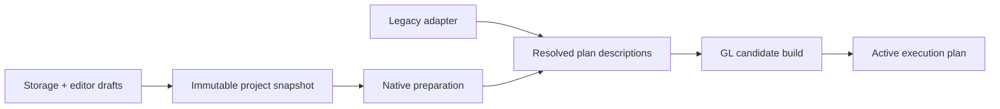

# Architecture and integration notes

Read SPEC.md for semantics. This file suggests boundaries and identifies existing integration points. Names here are conceptual; extend existing classes where practical rather than introducing parallel abstractions with nearly identical responsibilities.

## 1. One preparation path, one renderer

The legacy adapter converts old source metadata and resource lookups into the same execution descriptions. It may reuse source-map and compilation utilities. It must not make native parsing permissive or add `if legacy` branches throughout drawing code.

## 2. Minimal concepts

| Concept | Owns | Does not own |
| --- | --- | --- |
| Project locator/store | Read/write capability, stable local identity, logical-path-to-storage mapping, external revision checks | GLSL, GL handles, editor widgets |
| Editing session | Active file, per-file drafts and undo, dirty/save state, requested revision | Render dependency semantics |
| Project snapshot | Immutable text and revision-specific asset contents/references, entry and diagnostics provenance | Mutable provider reads during drawing |
| Program description | Prepared shader text, language/version, source map, interface requirements | A unique render pass or live GL context |
| Input binding | Target uniform symbol, source resource/producer, temporal mode, sampler settings | Global name lookup |
| Pass description | Instance identity, program reference, input bindings, output target | Storage origin |
| Executable plan | Linked programs, ordered passes, per-program bindings, target/history allocations | UI drafts or SAF access |

Do not turn every row into an interface plus factory plus registry. Plain records/value objects and a few concrete coordinators are sufficient. Keep the CPU-side planning types free of Android where useful for meaningful JVM tests. Text and binary assets are separate values; do not base64-encode images into `ShaderProjectFile.source`.

File authoring uses normalized shader paths as default pass identities. The runtime receives an explicit instance ID distinct from a program identity. Do not require identical source text to compile twice, but defer content-hash program caches until profiling justifies them. Shared includes and small wrapper files are the initial user-facing reuse mechanism.

## 3. Existing code to inspect

All paths below are under `app/src/main/java/de/markusfisch/android/shadereditor/` unless noted. The checkout may have evolved; verify actual callers before editing.

| Area | Starting points | Required integration |
| --- | --- | --- |
| Project models | `project/ShaderProject*`, `*ShaderProjectSource` | Keep origins/locators separate from semantic descriptions; support binary resources and revision snapshots |
| Editor/session loading | `activity/managers/ShaderManager`, `ShaderViewManager` | Stop reducing every session to the entry source; route save to its actual store |
| Navigation | `activity/managers/NavigationManager`, `activity/PreviewActivity` | Small recoverable session/snapshot identifiers instead of serialized project payloads |
| Editor UI | `fragment/EditorFragment`, `widget/ShaderEditor`, `view/UndoRedo` | File-aware editing, source diagnostics, separate per-file history |
| Source preparation | `opengl/ShaderSourcePreparer`, `PreparedShaderSource`, `ShaderLineMapping`, `ShaderError` | Add native lexer/assembly/maps; preserve legacy preparation inside adapter |
| Program lifecycle | `opengl/RendererProgramManager` | Candidate build/activation; old plan survives failed build |
| Rendering | `opengl/ShaderRenderer`, `ShaderRenderPipeline` | Consume ordered plan; targets per instance; project-wide frame transaction |
| GL/resources | `opengl/GlDevice`, `ProgramBindings`, `ShaderTextureResources`, GL wrappers | Correct sampling variants, typed targets, queried limits, lifecycle ownership |
| Builtins | `opengl/BuiltinUniforms`, sensor/system/camera helpers | Graph-wide provider demand and frame capture; per-pass bindings/coordinate transform |
| Persistence/library | DAOs, `io/ExternalFile`, import/export helpers, library manager | Preserve DB-backed records; new native project registry and stores |
| Wallpaper | `service/ShaderWallpaperService`, preferences | Durable installed snapshot and preserved legacy selection/runtime behavior |
| Resource insertion | AddUniform activity/fragments, texture pickers | Generate native annotations and local copies for native sessions |

At the inspected base, `ShaderProjectSession` is serializable, `ShaderProjectFile` is text-only, preview callers extract `getEntryPointSource()`, and `saveShader()` writes back to the legacy database. The folder source class is not a complete SAF persistence layer. These are integration gaps, not a reason to replace the entire application architecture.

## 4. Preparation and validation order

1. Obtain a consistent requested snapshot and revision ID.
2. Read/validate manifest and entry; lex entry input annotations into unresolved input descriptions.
3. Resolve required shader dependencies with a visited/in-progress graph, recording edges without assuming previous edges are acyclic.
4. Assemble includes for each reachable program, consume annotations, and produce source maps. Perform path/metadata/conditional placement validation on original text.
5. Validate static current-edge DAG, targets, resource types, and host resource bounds.
6. Decode immutable image data on a worker; do not open files in draw calls.
7. On the GL thread, compile/link a candidate, inspect active uniform types, configure builtin demand, and allocate/upload resources.
8. Recheck revision freshness; activate only a completely ready candidate at a frame boundary.

Do not use linked-uniform optimization to rewrite explicit graph reachability. Reflection is appropriate for type checks and demand for implicit engine inputs such as backbuffer. It is not a substitute for parsing declared dependencies.

Cancellation/freshness rules apply to parse, decode, and GL completion. A cancelled candidate must release resources when safe. A failed activation never marks a draft saved or an old preview current.

## 5. CPU and GPU ownership

- UI owns editing intent and presentation of state. Storage/preparation workers own expensive CPU/I/O work.
- GL handles live on the owning context/thread. Never share handles between preview and wallpaper contexts.
- Immutable CPU snapshots may be reused; each context builds its own executable plan.
- Keep pending candidate and active plan separate. Building a new program must not clear active programs first.
- Distinguish deleting valid GL objects from discarding handles after context loss.
- Query capabilities once per context, then validate candidate requirements against that snapshot.
- Resource budgeting includes old+candidate coexistence, historical outputs, retained presentation output, decoded images, and GLES2 sampling variants. Allocation failure keeps the old plan when the context remains usable and reports actionable diagnostics.

Keep a project-wide frame snapshot for time/sensors/camera. Per-pass `ProgramBindings` set the program's own target dimensions, coordinate-transformed pointers, explicit inputs, and fixed historical references. Avoid repeatedly configuring/releasing builtin listeners for each pass.

## 6. Sampling correctness on GLES2

Sampling parameters are properties of an input in the authoring model. GLES2 texture-object state does not implement independent simultaneous sampler states for one object. This is a required correctness case, not an optional optimization.

Use a small backend mechanism that materializes distinct texture variants as needed on GLES2, or another demonstrably correct strategy. Refresh dynamic pass variants once after the producer writes. Sharing source storage must never make one consumer's wrap/filter silently affect another. Preserve immutable previous outputs until frame commit. GLES3 sampler objects can avoid copies. Do not rerun a shader to obtain differently sampled copies.

## 7. Storage without a sync platform

Use one small document-access implementation for native files: logical paths map to opaque document URIs, accessed through ContentResolver/DocumentsContract. ShaderEditor's own DocumentsProvider exposes an app-owned user-files directory through those same operations. A single-document grant is a restricted locator, not a different format/store framework. Preserve DB operations through the existing legacy boundary. Do not add separate managed/linked/imported project implementations or a mount/plugin registry.

Implement only the provider contract needed by Android Files and authoring: roots, document/child queries, open/read/write, create, supported rename/delete, child containment, correct MIME types/capability flags, and change notifications. Advertise only implemented operations. Register the exported provider with grantUriPermissions and the system MANAGE_DOCUMENTS permission plus DOCUMENTS_PROVIDER intent filter. Stable opaque IDs must not be casually invalidated by supported rename; use stable backing identity or the platform's documented replacement-ID behavior and update local locators/grants accordingly. A path-prefix string check is not sufficient containment validation. Reject traversal and links escaping the exposed user-files root. Test direct/malformed IDs as well as picker navigation. App-private DB/drafts/cache/wallpaper directories are outside that root.

Use ACTION_OPEN_DOCUMENT_TREE for folders and creation destinations, ACTION_OPEN_DOCUMENT for individual files/resources, and the initial-URI hint where supported. Respect system-disallowed folders and granted read/write flags; persist only actually offered persistable grants. In-app default creation can address its own provider directly without asking for a permission it already owns. External apps still use Android's normal grants. A known tree grant may be reused for a file only after verifying containment; do not infer a parent from URI string structure.

Open lazily. Snapshot collection traverses required dependencies and overlays drafts; it does not first enumerate/copy the whole tree. Rendering, sharing, Save a copy, and wallpaper reuse dependency/path collection with explicit completeness requirements. Rendering/wallpaper require a valid candidate; sharing can preserve incomplete sources with a clear warning. No compilation is needed just to package sources.

Keep durable drafts independent of saving and compilation. Refresh on return/explicit Refresh and use provider notifications where available; do not rely on universal filesystem watchers or modification timestamps alone. Compare content for edited files when provider revisions are unreliable. Once an external conflict is found, suspend autosave for that file until the user resolves it; Keep my edits still requires an explicit overwrite/save before resuming autosave. Remote writes can race after checks where the provider lacks compare-and-swap; report available guarantees honestly, without inventing a sync engine.

A bounded snapshot loader plus save API with per-file outcomes is enough. Handle partial writes and preserve retryable drafts. Use app-private staging/publication for installed wallpaper revisions and archive validation, not a hidden clone for ordinary folder editing.

Maintain stable local session/recent IDs as app metadata. Folder/document locators identify storage; display names are not identity. Normalize own-provider and external-open routes to the same document/session where possible without guessing arbitrary provider identities. Removing a recent shortcut never deletes source files. Directory moves by other apps may invalidate locators; offer Choose folder again and retain drafts.

## 8. Avoid these implementation detours

- No app-wide rewrite, Compose migration, new DI framework, or speculative module split.
- No full custom GLSL preprocessor. V1 explicitly uses static include assembly and restricted host annotations.
- No metadata synthesized by guessing variable names or interpreting arbitrary comments.
- No sidecars, graph manifest, pass override precedence, script API, or plugin/provider registry without an actual current requirement.
- No new legacy features. Existing comment metadata stays behind the adapter.
- No huge fixtures encoded into Java strings merely to avoid resource loading.
- No benchmark or test that just repeats the implementation's internal algorithm; verify observable semantics with independent expected outcomes.
