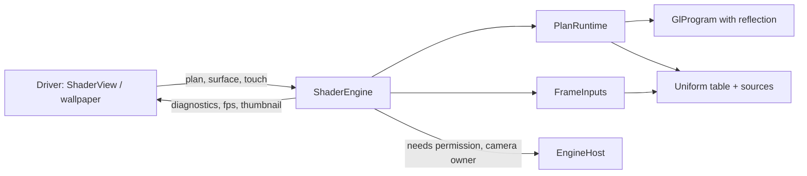

# Rendering engine: diagnosis and design

This file covers the engine and its driver, for existing DB shaders as much as for project mode. It is the design behind `PlanRuntime` in ARCHITECTURE 2. The engine work is a track of its own (IMPLEMENTATION, track E): every step is useful without project mode and can land upstream by itself.

Paths are under `app/src/main/java/de/markusfisch/android/shadereditor/`. Findings refer to checkout `cf4ac23`. The engine now follows the design in section 2; section 1 and the left column of section 3 name the code it replaced, which is deleted.

## 1. What was wrong

### One uniform is declared in up to seven places

Take `battery`:

| Place | What is repeated |
| --- | --- |
| `opengl/ShaderRenderer` | The name, as a public `UNIFORM_BATTERY` constant |
| `opengl/BuiltinSystemUniforms` field | `hasBattery` |
| `BuiltinSystemUniforms.configure` | `hasBattery = device.hasUniform(...)` |
| `BuiltinSystemUniforms.apply` | `if (hasBattery) ... bindings.setFloat(...)`, which fixes the type |
| `BuiltinSystemUniforms` fields | The value and its refresh timestamp |
| `adapter/PresetUniformAdapter` | The name again, and the type again as the string `"float"` |
| `res/values/strings.xml` | The description |

The `UNIFORM_*` constants are referenced 143 times across six files. Nothing checks that the type in the adapter, the setter in the module, and the declaration in the user's shader agree; a mismatch renders garbage without a message. Sensor uniforms repeat the pattern with a listener field, a registration block, and a release block each.

### The same fact is tracked in five layers

"Does the program use uniform X, and where?" is answered separately by:

1. `has*` booleans in the three `Builtin*Uniforms` modules;
2. `GlProgram.uniformLocations`, a `HashMap<String, Integer>` filled lazily and queried by name for every uniform on every frame;
3. `ProgramBindings`, a second name-keyed map whose `active` flags are cleared and set again every frame;
4. the `location > -1` guard inside every `GlDevice.uniform*` call;
5. for samplers, a regex over the source text (`ShaderSourcePreparer.PATTERN_SAMPLER`), which also matches declarations in comments and misses ones built by macros.

Frame uniforms such as `time` skip layer 1 and rely on layer 4; sensor uniforms use layers 1 through 4. Texture bindings pass through `DiscoveredSampler`, `SamplerTextureBinding`, `ProgramBindings.TextureValue`, and `GlStateCache` before reaching GL. The state cache then needs a `markBindingDirty` escape hatch because the camera rebinds its texture behind the cache's back.

### Hidden dependencies

| Where | Dependency |
| --- | --- |
| `BuiltinUniforms.updateSurface` | Computes the render-target size and resets clock, frame number, and `startRandom`. The renderer asks the uniform module how large its framebuffers are. |
| `BuiltinCameraUniforms`, `BuiltinSystemUniforms` | Cast the `Context` to `Activity` to request permissions, from the GL thread. Cast it to `LifecycleOwner` to open the camera, so the camera silently does nothing in the wallpaper service. |
| `BuiltinSystemUniforms.apply` | Reads the `ShaderEditorApp.preferences` global and `NotificationService` statics. |
| `ShaderTextureResources.load`, `BackBufferParameters.getPresetBitmap` | Query the database singleton and decode bitmaps on the GL thread, the second one from inside `onDrawFrame`. |
| `ShaderSourcePreparer` | Imports a name pattern from a UI fragment (`AbstractSamplerPropertiesFragment`). |
| `TextureParameters` | One mutable class is the UI model, the `///` comment codec, and the GL state. `BackBufferParameters` extends it with database access and bitmap tiling. |
| `widget/ShaderView.setFragmentShader` | Reloads a shader by calling `onPause()` then `onResume()`. That destroys and recreates the EGL context; `reload` runs only in `onSurfaceCreated`. Every edit rebuilds every GL resource, and a compile error leaves a black preview. |
| `ShaderRenderer.getThumbnail` | The UI thread blocks on `wait(1000)` for the GL thread. |
| `touchAt`, `setOffset` | The UI thread writes arrays that the GL thread reads, without synchronization. |

### Shallow modules

`GlDevice` (616 lines) forwards GL calls one to one and keeps a state cache whose savings do not matter at a handful of draws per frame. `Mesh`, `Geometry`, and `VertexAttribute` model arbitrary meshes for one full-screen quad, and `GlDevice.draw` duplicates the vertex buffer on every frame. `PreparedShaderInput`, `PreparedShaderSource`, `DiscoveredSampler`, `GlProgramBuildResult`, and `RendererProgramManager.ReloadResult` each wrap two or three fields and are unpacked by their only caller. `GpuBitmapTransformer` (503 lines) carries a second copy of context setup, program compilation, and quad drawing.

## 2. Design

Five parts, each with one job and a small surface. The rule that removes the duplication: **a program describes itself once at link time, and a uniform is declared once in a table. Everything else is derived.**



### 2.1 `GlProgram` reflects itself

Linking enumerates the active uniforms once (`glGetActiveUniform`) into an immutable list of slots: name, GL type, array size, location, and a texture unit for samplers. There is no lazy lookup, no name query per frame, and no source regex. "Which samplers does this shader use" and "does it use `battery`" are both answered by this list. It also exposes facts nobody could report before: a uniform the engine does not provide, and a uniform declared with the wrong type.

### 2.2 The uniform table

Every builtin is one entry. The table is the only place a builtin is declared.

The code below shows the shape; names and string resources are illustrative.

```java
static final List<UniformDef> BUILTINS = List.of(
    uniform("time",       FLOAT, R.string.time_in_seconds,
            (in, out) -> out.set(in.time)),
    uniform("resolution", VEC2,  R.string.resolution_in_pixels,
            (in, out) -> out.set(in.width, in.height)),
    uniform("battery",    FLOAT, R.string.battery_level, Battery::new,
            (battery, out) -> out.set(battery.level())),
    uniform("gravity",    VEC3,  R.string.gravity_vector, Gravity::new,
            (gravity, out) -> out.set(gravity.values())),
    ...
);
```

A value that needs the outside world comes from a source:

```java
interface UniformSource {
    void start(EngineHost host, UniformSources sources);  // register listeners; may report a missing permission
    void stop();
    default void update(long now) {}    // once per frame, before any write; throttle here
}
```

The engine does the rest, the same way for every uniform:

1. After linking, intersect each program's slots with the table. A type mismatch is a located diagnostic.
2. Start the sources that at least one active uniform of any pass needs; stop the ones no longer needed. Several uniforms share one source (`rotationMatrix`, `orientation`, `inclination`), and it starts once.
3. Per frame, call `update` once per running source, then run each active entry's writer against its location, per pass.

A table entry never mentions `has`, a location, registration, or release. The Add Uniform list (`PresetUniformAdapter`) and editor completion read the same table, so name, type, and description cannot drift.

Adding a uniform becomes: one table line, one string, and a `UniformSource` class only when new hardware is involved.

### 2.3 `FrameInputs`

Clock, frame number, pointer state, wallpaper offset, surface size, quality, and device rotation are plain engine state (`EngineInputs`), captured into one `FrameInputs` value at the start of a frame. Writers read it. Render size is computed by the engine from surface size and quality, not by a uniform class. Per-pass fields (`width`, `height`, pointer positions scaled to the pass) derive from the same capture, which is exactly the rule in SPEC 7.

### 2.4 `EngineHost`

The engine receives what it needs from its host through one explicit interface instead of casting a `Context`:

```java
interface EngineHost {
    Context context();
    boolean onPermissionNeeded(String permission);    // the host decides whether and how to ask; false: it cannot
    boolean onNotificationAccessNeeded();             // the same, for notification access
    @Nullable LifecycleOwner cameraOwner();           // null: camera inputs report "not available here"
}
```

`ContextEngineHost` in `widget/` implements it for `ShaderView`, which the editor, the preview activity, and the wallpaper service use; a context that is not an `Activity` cannot ask. No rendering code requests permissions or reads preference globals.

### 2.5 `ShaderEngine` and the driver

`ShaderEngine` is the only class the driver talks to:

```text
setPlan(plan)                    // any thread; applied on the GL thread at a frame boundary
onContextCreated / onContextLost
onSurfaceChanged(width, height)
drawFrame()
pointer(event) / offset(x, y)    // queued to the GL thread
requestThumbnail(callback)
listener: diagnostics, fps
```

`ShaderView` holds the `GLSurfaceView.Renderer` adapter, a few lines that call the engine. A new plan is built on the GL thread while the old one keeps drawing, and it replaces the old one only when it links. The EGL context survives edits. All engine state is touched on the GL thread only.

A plan is the `RenderPlan` of ARCHITECTURE 2, and `prepare` is its only producer. A DB shader is converted to project files in memory first (SPEC 12), so the engine has one dialect: name-based texture lookup, `///` comments, and backbuffer presets are known to the converter and to nothing else. Images are decoded before the plan reaches the GL thread.

## 3. What is deleted

| Before | Replaced by |
| --- | --- |
| `UNIFORM_*` constants, `has*` flags, `configure`/`apply`/`release` blocks | Uniform table and sources |
| `BuiltinUniforms`, `BuiltinSystemUniforms`, `BuiltinSensorUniforms`, `BuiltinCameraUniforms` | Table, sources, `FrameInputs` |
| `GlProgram` location maps, `ProgramBindings` | Reflected slots |
| `GlStateCache`, `markBindingDirty` | Explicit binds per draw |
| `PATTERN_SAMPLER`, `DiscoveredSampler`, `ShaderTextureResources` | Reflected sampler slots plus the plan's inputs |
| `Mesh`, `Geometry`, `VertexAttribute` | One full-screen quad |
| `RendererProgramManager`, the pass drawing of `ShaderRenderPipeline` | `PlanRuntime`; `ShaderRenderPipeline` now only presents the result and captures the thumbnail |
| `TextureParameters` as UI model, codec, and GL state | An immutable sampler-settings value (min, mag, mipmap, wrap per axis), `RenderPlan.Sampling`, applied by `GlSampling`; the `///` codec is in the converter (`LegacySamplerSettings`) |
| `BackBufferParameters` and its preset tiling | `se target initial` and a generated seed shader |
| Reload by context teardown, `wait(1000)` thumbnail | Plan swap on the GL thread, callback |

## 4. Improvements users see

These fall out of the design; none needs its own subsystem.

- A typo no longer blanks the preview: the last working shader keeps running until the new one links.
- Reload is faster, because the EGL context and unchanged textures survive.
- A uniform with the wrong type, or one that nothing provides, gets a warning with its fix instead of silent zeros. The shader still runs, so nothing that works today stops working.
- Builtin uniforms appear in editor completion with their types.
- Camera inputs say why they are unavailable instead of doing nothing.
- Per-input sampling and multipass (SPEC 4–7) build on the same runtime instead of a second one.

## 5. Rules for engine code

1. A builtin uniform exists in the table and nowhere else.
2. Nothing looks up a uniform or sampler by name after link.
3. Only the converter knows the old conventions. The runtime never asks where a plan came from, and nothing carries a legacy flag.
4. No database access, file access, bitmap decoding, permission request, or preference read on the GL thread.
5. Engine state changes on the GL thread only; other threads post.
6. No cache without a measurement that shows it is needed.
7. A class that only forwards to another class is removed, not wrapped.
